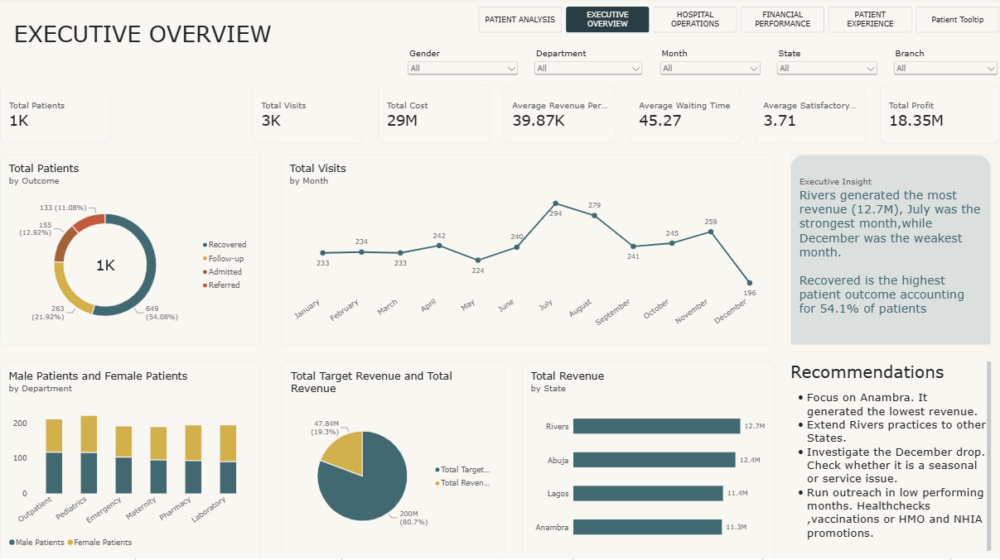
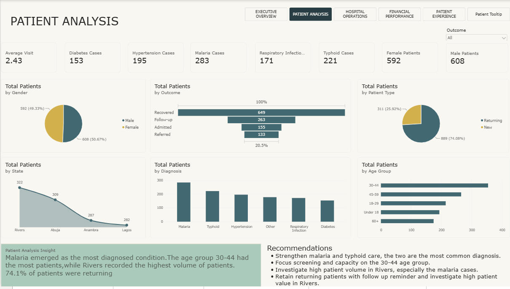
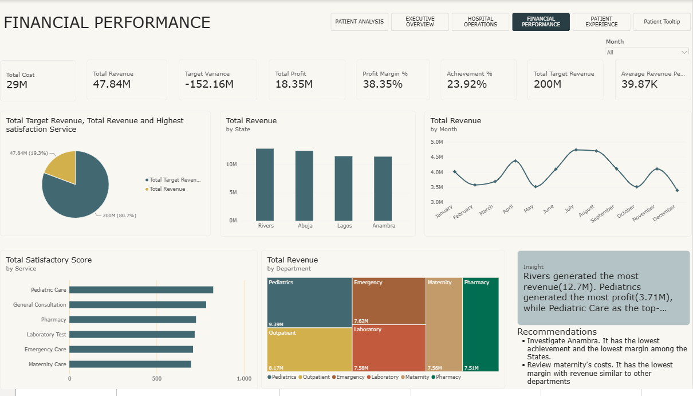

# Healthcare Performance & Patient Analytics Dashboard

An interactive Power BI dashboard analysing patient activity, hospital operations, financial performance and patient experience for a healthcare organisation operating across four Nigerian states (Abuja, Anambra, Lagos and Rivers).

**Author:** Olakusehin John
**Project:** IFEXA Power BI Final Project

---

## Project Overview

This project turns raw healthcare data into a five-page Power BI report that helps management understand how the organisation is performing, what patients are experiencing, and where attention is needed.

The report covers:

1. **Executive Overview**: headline KPIs, monthly visits, revenue by state, revenue vs target and outcomes
2. **Patient Analysis**: who the patients are (age, gender, diagnosis, state, new vs returning)
3. **Hospital Operations**: departments, waiting time, branch performance and monthly volume
4. **Financial Performance**: revenue, cost, profit, margin and target achievement
5. **Patient Experience**: satisfaction by department and branch, and its link to waiting time

---

## Business Problem

Management needs a single view that answers:

> *How is our healthcare organisation performing, what are our patients experiencing, and where are the major areas that require attention?*

---

## Dataset Description

The Excel workbook contains three sheets:

| Sheet | Rows | Description |
|---|---|---|
| `Patient_Visits` | 1,200 | One row per patient: Patient_ID, Visit_Date, State, Branch, Department, Service, Gender, Age, Diagnosis, Visit_Count, Waiting_Time_Min, Satisfaction_Score, Revenue_NGN, Cost_NGN, Outcome, Payment_Method, Insurance_Type |
| `State_Targets` | 4 | Annual revenue target per state (₦200M in total) |
| `Date_Table` | 365 | Calendar for 2025 (Year, Month number, Month, Quarter) |

**Key facts about the data**
- Each `Patient_ID` appears once, so *Total Patients* = 1,200, while *Total Visits* (the sum of `Visit_Count`) = 2,920.
- "Returning" patients are those with `Visit_Count` greater than 1.
- The data covers 2025 only, so year-over-year comparison is not possible.
- Department and Service map one-to-one.

---

## Tools Used

- **Power BI Desktop**: report, visuals and interactivity
- **Power Query**: data cleaning and transformation
- **DAX**: measures and calculated columns
- **Microsoft Excel**: source data
- **GitHub**: documentation and version control

---

## Data Cleaning Process

Steps carried out in Power Query:

1. Inspected all three sheets and checked data types
2. Checked for nulls, duplicates and extra spaces (none found in `Patient_Visits`)
3. Set correct data types (dates, whole numbers, decimals, text)
4. Created an **Age Group** column (0-14, 15-29, 30-44, 45-59, 60+)
5. Created a **Patient Type** column (New = 1 visit, Returning = more than 1 visit)
6. Separated the data into a fact table and dimension tables for the star schema

**Data quality observations (documented, not altered)**
- Many Maternity records are marked Male, and some Maternity patients are under 15 or over 50.
- Most Pediatrics records are for patients over 17.
- These look like data-capture inconsistencies and are worth a validation check at the point of entry.

---

## Data Model

The model follows a **star schema**:

- **Fact table:** `Fact_Visits`
- **Dimensions:** `Dim_Date`, `Dim_State` (with annual revenue target), `Dim_Branch`, `Dim_Department`

---

## DAX Measures

| Measure | Purpose |
|---|---|
| Total Patients | `DISTINCTCOUNT(Fact_Visits[Patient_ID])` |
| Total Visits | `SUM(Fact_Visits[Visit_Count])` |
| Total Revenue | `SUM(Fact_Visits[Revenue_NGN])` |
| Total Cost | `SUM(Fact_Visits[Cost_NGN])` |
| Total Profit | `[Total Revenue] - [Total Cost]` |
| Profit Margin % | `DIVIDE([Total Profit], [Total Revenue])` |
| Average Revenue per Patient | `DIVIDE([Total Revenue], [Total Patients])` |
| Average Waiting Time | `AVERAGE(Fact_Visits[Waiting_Time_Min])` |
| Average Satisfaction | `AVERAGE(Fact_Visits[Satisfaction_Score])` |
| Previous Month Revenue | `CALCULATE([Total Revenue], DATEADD(Dim_Date[Date], -1, MONTH))` |
| MoM Revenue Growth % | `DIVIDE([Total Revenue] - [Previous Month Revenue], [Previous Month Revenue])` |
| Previous Year Revenue | `CALCULATE([Total Revenue], SAMEPERIODLASTYEAR(Dim_Date[Date]))` |
| YoY Revenue Growth % | `DIVIDE([Total Revenue] - [Previous Year Revenue], [Previous Year Revenue])` |
| Revenue Target | `SUM(Dim_State[Annual_Revenue_Target_NGN])` |
| Revenue Variance | `[Total Revenue] - [Revenue Target]` |
| Achievement % | `DIVIDE([Total Revenue], [Revenue Target])` |
| Returning Patients % | Share of patients with more than one visit |
| Recovered Patients % | Share of patients with the outcome "Recovered" |

Previous Year and YoY measures return blank because the data covers 2025 only.

The report also uses **dynamic insight measures** that build text from the current filters (for example the top state, top department and recovery rate).

---

## Dashboard Screenshots

### Executive Overview

### Patient Analysis

### Hospital Operations

### Financial Performance

### Patient Experience

### Tooltip

---

## Key Insights

1. **Profitable, but far below target.** Revenue was ₦47.84M against ₦29.5M cost, giving ₦18.35M profit (38.35% margin). Revenue reached only 23.9% of the ₦200M annual target, a variance of about ₦152M. No state exceeded 28% achievement.
2. **Rivers led on revenue, Anambra lagged.** Rivers earned ₦12.7M, followed by Abuja (₦12.4M), Lagos (₦11.4M) and Anambra (₦11.3M). Anambra also had the lowest achievement (20.6%) against the highest target (₦55M).
3. **Demand peaks in July and drops in December.** Visits rose to 294 in July and fell to 196 in December, about 33% lower. Revenue followed the same pattern (₦4.74M in July vs ₦3.40M in December).
4. **Most patients recover, but many need continued care.** 54.1% of patients recovered, 21.9% needed follow-up, 12.9% were admitted and 11.1% were referred.
5. **Malaria and the 30-44 age group dominate patient volume.** Malaria was the most common diagnosis (283), followed by Typhoid (221) and Hypertension (195). The 30-44 age group was the largest (354 patients). Rivers recorded the most malaria cases (93).
6. **High retention.** 74.1% of patients (889) were returning patients, averaging 2.43 visits each. The remaining 311 had only one visit, including 67 who were marked for follow-up.
7. **Pediatrics is the strongest department.** It received the most patients (221) and visits (515), and produced the highest revenue (₦9.4M) and profit (₦3.71M, 39.5% margin). Maternity had the lowest margin (37.4%).
8. **Obio-Akpor stands out operationally.** It handled the most visits (303), had the longest branch waiting time (49.0 minutes) and the second-lowest satisfaction (3.62).
9. **Waiting time does not explain satisfaction.** The correlation between waiting time and satisfaction is effectively zero. Lekki had the shortest wait (40.7 minutes) but the lowest satisfaction (3.60), and Pharmacy scored highest among departments (3.74).

---

## Recommendations

**Financial**
- Review the revenue targets. At 24% achievement, check whether they are realistic or whether revenue is going unrecorded.
- Investigate Anambra, which has the widest target gap and the lowest margin among states.
- Review Maternity's costs, since it has the lowest department margin.
- Grow Pediatrics and Outpatient, the strongest revenue and profit departments.

**Operations**
- Investigate Obio-Akpor's patient flow and staffing, since it combines high volume with the longest wait.
- Review Laboratory turnaround times, the longest-waiting department (47.0 minutes).
- Plan staffing around the July peak and the December low.

**Patients**
- Focus capacity and screening on the 30-44 age group and on malaria and typhoid care, with Rivers as the priority for malaria.
- Retain returning patients with follow-up reminders, and investigate why 311 patients had only one visit, especially the 67 who needed follow-up.

**Patient experience**
- Collect patient feedback at Lekki to find the causes of its lower satisfaction, since waiting time does not explain it.

**Data quality**
- Add validation at data entry (for example gender and age checks for Maternity and Pediatrics).

---

## Conclusion

The organisation is profitable, with a healthy 38% margin and a loyal patient base, but revenue is only about a quarter of the annual target, and results vary by state, branch and month. The dashboard helps management focus on the areas that matter: target setting and Anambra's gap, Obio-Akpor's operations, the follow-up needs of patients, and seasonal staffing. The differences between departments in waiting time and satisfaction are small, so improvements are likely to come from targeted branch-level reviews and patient feedback rather than broad changes.

**Limitations:** the data covers one year (2025), so year-over-year trends cannot be assessed. "New" patients are defined as those with one recorded visit, which does not prove they never returned. The data shows what happened, not why, so the recommendations are areas to investigate.

